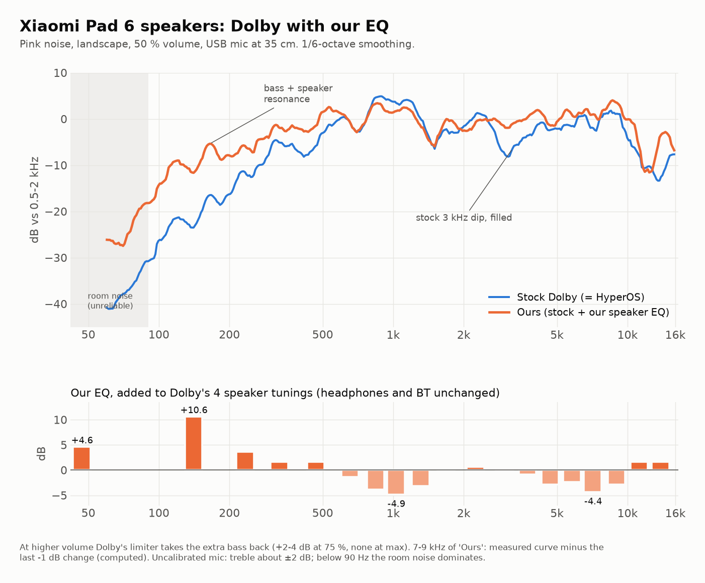

# pipa Dolby speaker EQ

A measured speaker EQ for the Xiaomi Pad 6 (pipa) Dolby Atmos (DAX3), made for the ColorOS 17 port (step 6a). Goal:
the stock HyperOS Dolby sound, a bit more "fun" (Harman/JBL-like): deeper bass, less upper bass, flat mids.



`make_graph.py` draws it from `curves.npz` (smoothed curves from the pink-noise recordings).

## Use

```
python3 apply_speaker_eq.py stock/vendor/etc/dolby/dax-default.xml dax-default.xml
```

- Input: the stock pipa HyperOS 2 `vendor/etc/dolby/dax-default.xml` (md5 `582003e70df30be8964df17610212ef3`).
  Result md5: `c6413875ca78c292ce5b179822ca7215`.
- Put the result at `/vendor/etc/dolby/dax-default.xml` with the same owner, mode and SELinux label.
- On the first boot Dolby rebuilds its settings database once (Dolby settings go back to default once).
- Only the 4 speaker tunings change. Headphones, Bluetooth and USB keep the stock sound. The user EQ in MiSound
  works on top, as before.

## The EQ (dB, added to the speaker audio optimizer)

| Hz | 47 | 141 | 234 | 328 | 469 | 656 | 844 | 1031 | 1313 | 1688 |
|---|---|---|---|---|---|---|---|---|---|---|
| dB | +4.6 | +10.6 | +3.6 | +1.6 | +1.6 | -1.4 | -3.9 | -4.9 | -3.2 | -0.1 |

| Hz | 2250 | 3000 | 3750 | 4688 | 5813 | 7125 | 9000 | 11250 | 13875 | 19688 |
|---|---|---|---|---|---|---|---|---|---|---|
| dB | +0.6 | +0.1 | -0.9 | -2.9 | -2.4 | -4.4 | -2.9 | +1.6 | +1.6 | -1.4 |

## How it was measured

- Tablet in landscape on its case, Dolby on, profile Dynamic (HyperOS uses Dynamic or Movie only).
- USB measurement mic (Fifine A6NEO) at about 35 cm, in front of the screen centre. 20 s pink noise, 1/6 octave.
  Profile Dynamic has a volume leveler and adaptive EQ, so sweeps give wrong deltas; pink noise does not.
- The stock port Dolby matches stock HyperOS (Notebookcheck pink-noise test) within 2-3 dB from 1 to 16 kHz.
- Dolby's regulator limits the bass at high volume: the +10 dB bass is about +13-17 dB at 50 % volume, +2-4 dB at
  75 %, 0 dB at maximum. No clipping: two-tone IMD at maximum volume 1.2 % (stock) -> 2.0 %.
- 2026-11-07: -1 dB more at 7.1 and 9 kHz after a listening A/B (user choice "B1"; -2 dB was too much).
- Tools: `maintainer/dolbytune/` (player, Dolby control, recording, analysis).
